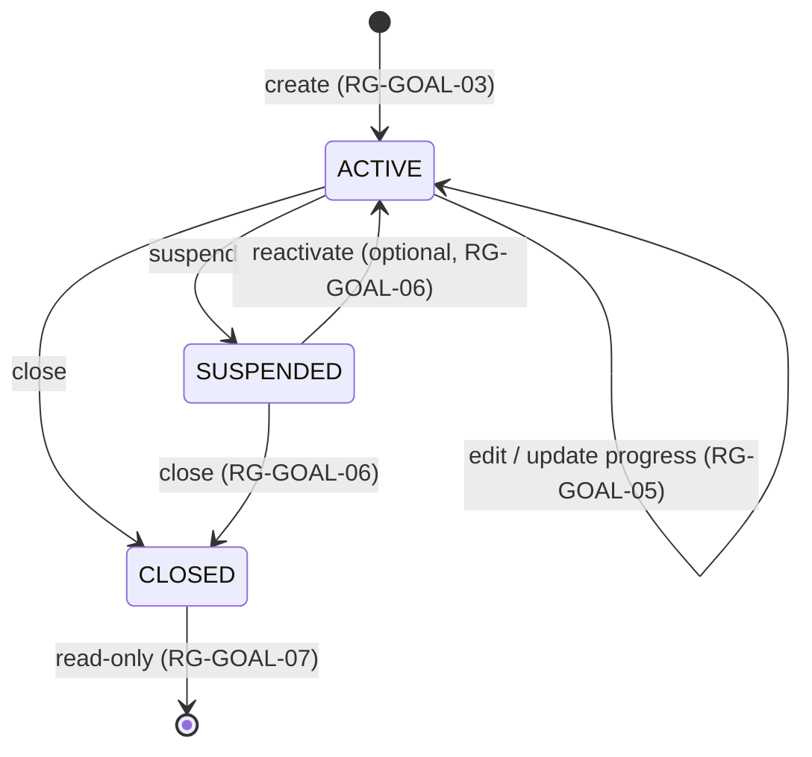

# Business rules

Source: HAC-PROD-001 §6 (translated). Linked acceptance criteria come from HAC-ACC-001, user stories from HAC-BACKLOG-001.
Code enforcing a rule must reference its id. The "Enforced in" column is updated as the code is written.

## Authentication & access (`AUTH`) — US-AUTH-01..03

| ID | Rule | Enforced in |
|---|---|---|
| RG-AUTH-01 | Access to PULSE requires a valid authentication through the HAC-API-001 contract. | — |
| RG-AUTH-02 | An account with status `DISABLED` cannot open a PULSE session. | — |
| RG-AUTH-03 | Visible and allowed features depend on the role returned by the authentication service. | — |
| RG-AUTH-04 | `USER` gives access to personal features, never to functional administration. | — |
| RG-AUTH-05 | `FUNCTIONAL_ADMIN` gives access to functional administration but **no** global access to users' personal data. | — |
| RG-AUTH-06 | An unavailable authentication service must not be reported as wrong credentials; the user gets a distinct message. | — |

## Profile & preferences (`PREF`) — US-PREF-01..02

| ID | Rule | Enforced in |
|---|---|---|
| RG-PREF-01 | A user can only read and update **their own** preferences. | — |
| RG-PREF-02 | Priority theme ∈ `ACTIVITE`, `SOMMEIL`, `HYDRATATION`, `STRESS`, `NUTRITION`. | `Categorie` enum |
| RG-PREF-03 | Reminder frequency ∈ `QUOTIDIEN`, `HEBDOMADAIRE`, `AUCUN`. | `FrequenceRappel` enum |
| RG-PREF-04 | Preferred time ∈ `MATIN`, `MIDI`, `SOIR`. | `MomentPrefere` enum |
| RG-PREF-05 | The user can enable/disable notifications and say whether they want to take part in challenges. | — |
| _(implicit)_ | One preference record per user. | `Preference.userId` unique |

## Personal goals (`GOAL`) — US-GOAL-01..04

| ID | Rule | Enforced in |
|---|---|---|
| RG-GOAL-01 | A goal belongs to a single user and can only be edited by that user. | `Objectif.userId` (not null) |
| RG-GOAL-02 | A goal has at least a label, a category, a **positive** target value and a unit. | not null only — `> 0` not enforced |
| RG-GOAL-03 | A new goal is created in state `ACTIVE`. | — |
| RG-GOAL-04 | Supported states: `ACTIVE`, `SUSPENDED`, `CLOSED`. | `StatutObjectif` enum |
| RG-GOAL-05 | An `ACTIVE` goal can be modified, suspended or closed. | — |
| RG-GOAL-06 | A `SUSPENDED` goal stays visible and can be closed; reactivation is optional (squad decision, see `decisions.md`). | — |
| RG-GOAL-07 | A `CLOSED` goal is finished and can no longer be modified. | — |
| RG-GOAL-08 | The progress value must never be negative. | — |

Allowed transitions:

## Collective challenges (`CHAL`) — US-CHAL-01..05

| ID | Rule | Enforced in |
|---|---|---|
| RG-CHAL-01 | Challenge statuses: `OPEN`, `UPCOMING`, `CLOSED`. | `StatutDefi` enum |
| RG-CHAL-02 | An `OPEN` challenge can be joined voluntarily. | — |
| RG-CHAL-03 | An `UPCOMING` challenge can be viewed but not joined yet. | — |
| RG-CHAL-04 | A `CLOSED` challenge can be viewed but no longer joined. | — |
| RG-CHAL-05 | A user can have only **one active participation** per challenge (repeating "join" must not create duplicates). | — |
| RG-CHAL-06 | Participation states: `ACTIVE`, `LEFT`, `COMPLETED`. | `StatutParticipation` enum |
| RG-CHAL-07 | Leaving a challenge sets the participation to `LEFT`. | — |
| RG-CHAL-08 | The progress shown for a challenge is the connected user's. | — |
| _(note)_ | A user whose participation is `LEFT` can join again while the challenge is `OPEN`. The squad chooses: new participation or reactivate the old one (see `decisions.md`). | — |
| RG-CHAL-09 | **Referenced in HAC-BACKLOG-001 (US-CHAL-02/03) but not defined anywhere** — open question. | — |

## Progress (`PROG`) — US-PROG-01..02

| ID | Rule | Enforced in |
|---|---|---|
| RG-PROG-01 | The progress summary is strictly personal. | — |
| RG-PROG-02 | It may combine the user's metrics, goals and challenge participations. | — |
| RG-PROG-03 | Missing data is shown as an empty state / explicit indication, never as an error. | — |
| RG-PROG-04 | No nominative ranking between employees. | — |

## Functional administration (`ADM`) — US-ADM-01..04

| ID | Rule | Enforced in |
|---|---|---|
| RG-ADM-01 | The admin area is reserved to `FUNCTIONAL_ADMIN`. | — |
| RG-ADM-02 | Creating and modifying challenges is the admin priority (MUST). | — |
| RG-ADM-03 | A challenge requires title, category, description, period, target, unit and a **consistent** status. | not null only |
| RG-ADM-04 | Content management is SHOULD. Types: `ARTICLE`, `FICHE`, `CONSEIL`; statuses `DRAFT`, `PUBLISHED`. | `TypeContenu`, `StatutContenu` enums |
| RG-ADM-05 | A `DRAFT` content is not considered published. | — |
| RG-ADM-06 | Administration must not offer any generic access to browse users' personal data. | — |

"Consistent" (RG-ADM-03, ACC-ADM-05) is interpreted as at least: `startDate <= endDate`, `targetValue > 0`,
non-blank text fields, status allowed. Record any stricter interpretation in `decisions.md`.

## Confidentiality (`CONF`)

| ID | Rule |
|---|---|
| RG-CONF-01 | Goals, preferences, participations and progress indicators are individual data. |
| RG-CONF-02 | They stay in the user's personal space and are never exposed to the client company. |
| RG-CONF-03 | Development and acceptance use **only** the synthetic data of HAC-DATA-001. |
| RG-CONF-04 | PULSE performs no medical diagnosis and never presents information as medical advice. |

## Technical constraints (HAC-TECH-001, HAC-API-001, HAC-ACC-001 §10)

- The auth service URL is configurable; no secret or real password in the repository (ACC-AUTH-11, ACC-SEC-01).
- Auth service calls are grouped in one identifiable place of the code (ACC-QUAL-02).
- Auth service responses are checked before use; 400 / 401 / 403 / 503 and invalid responses are handled explicitly (ACC-SEC-05/06).
- User inputs are validated before reaching business logic (ACC-SEC-03).
- Authorization is enforced server-side, not only by hiding UI buttons (ACC-AUTH-15, ACC-SEC-04).
- Error messages never expose stack traces, internal paths or infrastructure config (ACC-GEN-06, ACC-SEC-07).
- Passwords (even demo ones) are never returned by an API nor written to logs (ACC-SEC-02).
- No direct access to the historical PostgreSQL database (HAC-TECH-001 §4.3).
