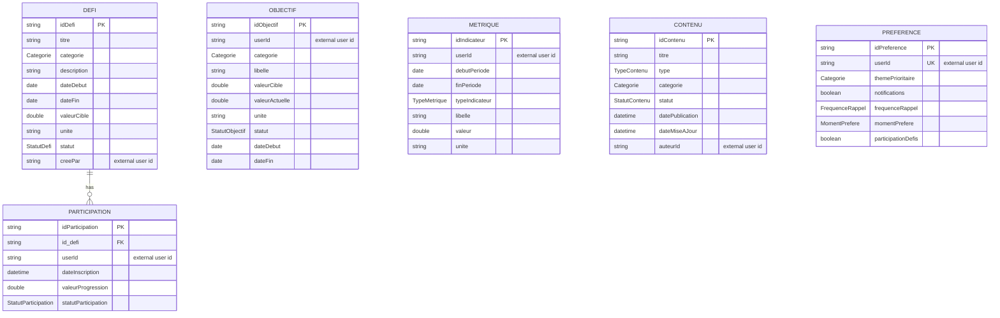

# Data model

Source of truth: `pulse/src/main/java/com/pulse/backend/entity/` and `.../enums/`.
Keep this file in sync with the code.

## Overview

Current names are shown below; the target English names are listed in "Target English naming".

There is **no `User` entity**: users are managed by an external authentication service (see `auth-simulator.md`).
Entities reference a user through a plain `String` identifier returned by that service (e.g. `usr-10027`),
stored in `userId`, `auteurId` or `creePar`. These are **not** foreign keys.

The only JPA relationship is `Participation` → `Defi` (many-to-one).

## Common mapping rules

- Primary keys: `String`. Currently generated as UUID (`@GeneratedValue(strategy = GenerationType.UUID)`) — **must change**:
  fixture records keep their HAC-DATA-001 ids (`chl-001`, `goal-001`, …) because acceptance scenarios reference them.
  Ids must be assignable; records created at runtime get a generated id (format: `decisions.md` D6).
- Enums: stored as their name (`@Enumerated(EnumType.STRING)`).
- Enum values are **reference values imposed by the specs** (RG-PREF-02..04, RG-ADM-04, HAC-DATA-001) and are kept
  exactly as-is, including the French ones (`ACTIVITE`, `QUOTIDIEN`, `MATIN`, `FICHE`, …). Only class / field names are translated.
- Table names are set explicitly with `@Table(name = ...)`; column names follow Spring Boot's default naming strategy (camelCase → snake_case).
- "Required" below means `@Column(nullable = false)` (database constraint only — no Bean Validation annotations yet).

## Entities

### Defi — table `defi`

A challenge that users can join.

| Field | Type | Required | Notes |
|---|---|---|---|
| `idDefi` | String (UUID) | PK | |
| `titre` | String | yes | |
| `categorie` | `Categorie` | yes | |
| `description` | String | yes | max length 1000 |
| `dateDebut` | LocalDate | yes | |
| `dateFin` | LocalDate | yes | |
| `valeurCible` | double | yes | target value |
| `unite` | String | yes | unit of `valeurCible` |
| `statut` | `StatutDefi` | yes | |
| `creePar` | String | yes | external user id of the creator |

### Participation — table `participation`

A user's enrolment in a challenge.

| Field | Type | Required | Notes |
|---|---|---|---|
| `idParticipation` | String (UUID) | PK | |
| `defi` | `Defi` | yes | `@ManyToOne(fetch = LAZY)`, column `id_defi` |
| `userId` | String | yes | external user id |
| `dateInscription` | LocalDateTime | yes | enrolment date |
| `valeurProgression` | double | yes | progress towards the challenge target |
| `statutParticipation` | `StatutParticipation` | yes | |

### Objectif — table `objectif`

A personal goal set by a user.

| Field | Type | Required | Notes |
|---|---|---|---|
| `idObjectif` | String (UUID) | PK | |
| `userId` | String | yes | owner (RG-GOAL-01) |
| `categorie` | `Categorie` | yes | |
| `libelle` | String | yes | label |
| `valeurCible` | double | yes | must be > 0 (RG-GOAL-02) |
| `valeurActuelle` | double | yes | must never be negative (RG-GOAL-08) |
| `unite` | String | yes | |
| `statut` | `StatutObjectif` | yes | `ACTIVE` at creation (RG-GOAL-03) |
| `dateDebut` | LocalDate | no | |
| `dateFin` | LocalDate | no | |

### Metrique — table `metrique`

An aggregated indicator computed for a user over a period.

| Field | Type | Required | Notes |
|---|---|---|---|
| `idIndicateur` | String (UUID) | PK | does not match the entity name — target `metricId` (see "Target English naming") |
| `userId` | String | yes | external user id |
| `debutPeriode` | LocalDate | yes | period start |
| `finPeriode` | LocalDate | yes | period end |
| `typeIndicateur` | `TypeMetrique` | yes | |
| `libelle` | String | yes | label |
| `valeur` | double | yes | |
| `unite` | String | yes | |

### Contenu — table `contenu`

Editorial content (article, sheet, tip).

| Field | Type | Required | Notes |
|---|---|---|---|
| `idContenu` | String (UUID) | PK | |
| `titre` | String | yes | |
| `type` | `TypeContenu` | yes | |
| `categorie` | `Categorie` | yes | |
| `statut` | `StatutContenu` | yes | |
| `datePublication` | LocalDateTime | no | null while not published |
| `dateMiseAJour` | LocalDateTime | yes | last update |
| `auteurId` | String | yes | external user id of the author |

### Preference — table `preference`

A user's settings. One row per user.

| Field | Type | Required | Notes |
|---|---|---|---|
| `idPreference` | String (UUID) | PK | |
| `userId` | String | yes | **unique** — external user id |
| `themePrioritaire` | `Categorie` | yes | preferred theme |
| `notifications` | boolean | yes | notifications enabled |
| `frequenceRappel` | `FrequenceRappel` | yes | reminder frequency |
| `momentPrefere` | `MomentPrefere` | yes | preferred time of day |
| `participationDefis` | boolean | yes | opted in to challenges |

## Enums

| Enum | Values | Used by |
|---|---|---|
| `Categorie` | `ACTIVITE`, `SOMMEIL`, `HYDRATATION`, `STRESS`, `NUTRITION` | Defi, Objectif, Contenu, Preference |
| `StatutDefi` | `OPEN`, `UPCOMING`, `CLOSED` | Defi |
| `StatutParticipation` | `ACTIVE`, `LEFT`, `COMPLETED` | Participation |
| `StatutObjectif` | `ACTIVE`, `SUSPENDED`, `CLOSED` | Objectif |
| `StatutContenu` | `DRAFT`, `PUBLISHED` | Contenu |
| `TypeContenu` | `ARTICLE`, `FICHE`, `CONSEIL` | Contenu |
| `TypeMetrique` | `WEEKLY_ACTIVE_DAYS`, `STREAK_DAYS`, `WELLBEING_CHECKINS`, `CHALLENGES_ACTIVE`, `GOALS_CLOSED`, `HYDRATION_DAYS` | Metrique |
| `FrequenceRappel` | `QUOTIDIEN`, `HEBDOMADAIRE`, `AUCUN` | Preference |
| `MomentPrefere` | `MATIN`, `MIDI`, `SOIR` | Preference |

## Target English naming

The project language is English. Target names follow the column headers of HAC-DATA-001 so the fixtures map 1:1.
Enum **values** do not change.

| Current class | Target class | Table | Current → target fields |
|---|---|---|---|
| `Defi` | `Challenge` | `challenge` | `idDefi`→`challengeId`, `titre`→`title`, `categorie`→`category`, `dateDebut`→`startDate`, `dateFin`→`endDate`, `valeurCible`→`targetValue`, `unite`→`unit`, `statut`→`status`, `creePar`→`createdBy` |
| `Participation` | `Participation` | `participation` | `idParticipation`→`participationId`, `defi`→`challenge` (column `challenge_id`), `dateInscription`→`joinedAt`, `valeurProgression`→`progressValue`, `statutParticipation`→`status` |
| `Objectif` | `Goal` | `goal` | `idObjectif`→`goalId`, `categorie`→`category`, `libelle`→`label`, `valeurCible`→`targetValue`, `valeurActuelle`→`currentValue`, `unite`→`unit`, `statut`→`status`, `dateDebut`→`startDate`, `dateFin`→`endDate` |
| `Metrique` | `Metric` | `metric` | `idIndicateur`→`metricId`, `debutPeriode`→`periodStart`, `finPeriode`→`periodEnd`, `typeIndicateur`→`metricType`, `libelle`→`label`, `valeur`→`value`, `unite`→`unit` |
| `Contenu` | `Content` | `content` | `idContenu`→`contentId`, `titre`→`title`, `categorie`→`category`, `statut`→`status`, `datePublication`→`publishedAt`, `dateMiseAJour`→`updatedAt`, `auteurId`→`authorId` |
| `Preference` | `Preference` | `preference` | `idPreference`→`preferenceId`, `themePrioritaire`→`priorityTheme`, `frequenceRappel`→`reminderFrequency`, `momentPrefere`→`preferredTime`, `participationDefis`→`challengeParticipation` |

| Current enum | Target enum (values unchanged) |
|---|---|
| `Categorie` | `Category` |
| `StatutDefi` | `ChallengeStatus` |
| `StatutParticipation` | `ParticipationStatus` |
| `StatutObjectif` | `GoalStatus` |
| `StatutContenu` | `ContentStatus` |
| `TypeContenu` | `ContentType` |
| `TypeMetrique` | `MetricType` |
| `FrequenceRappel` | `ReminderFrequency` |
| `MomentPrefere` | `PreferredTime` |

Note: `value` is a reserved word in some SQL dialects — map `Metric.value` with `@Column(name = "metric_value")`.

## Gaps between the code and the specs (to fix)

- Class, field and table names are still in French (see "Target English naming").
- Ids are generated UUIDs; fixture ids from HAC-DATA-001 cannot be kept.
- No Bean Validation yet: RG-GOAL-02 (target > 0), RG-GOAL-08 (progress ≥ 0), RG-ADM-03 (consistent challenge) are not enforced.
- No uniqueness guarantee for "one active participation per user and challenge" (RG-CHAL-05) — must be checked in the service
  (a plain unique constraint on `(challenge, userId)` would block re-joining after `LEFT`).
